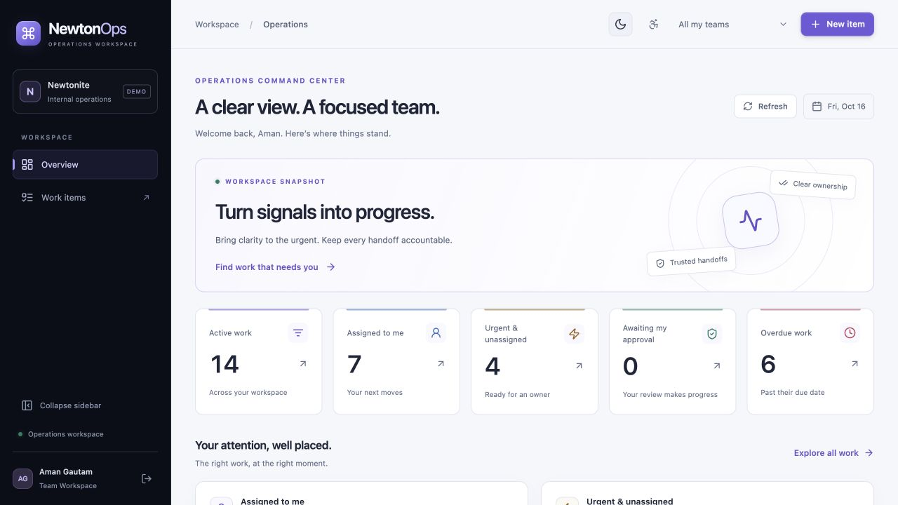
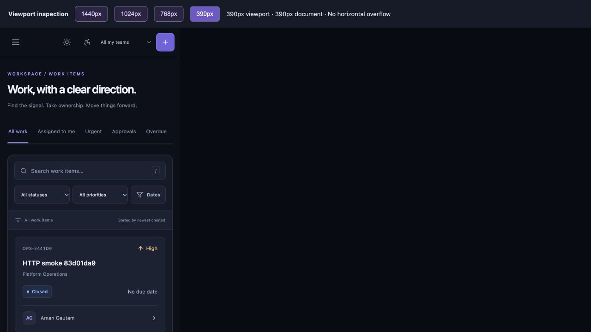
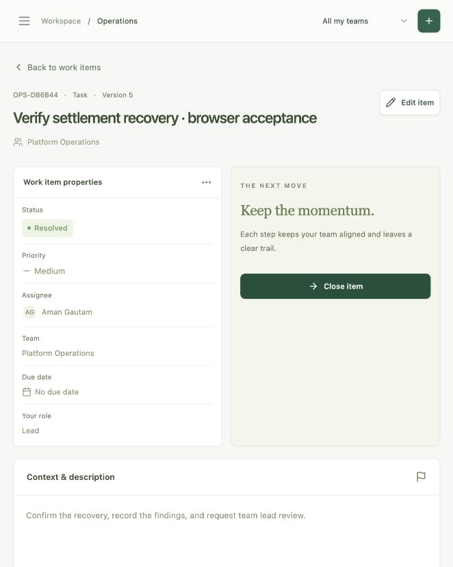
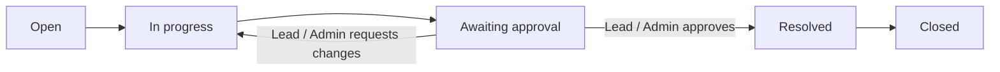
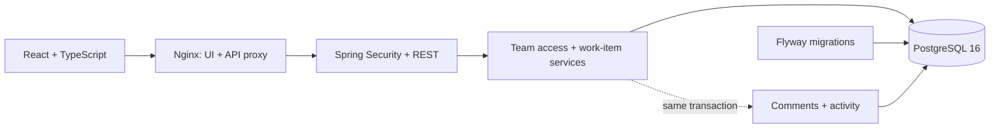

<div align="center">

# NewtonOps

### Clarity in every operation.

An operations workspace for teams that need clear ownership, controlled approvals, and a reliable record of every handoff.

[](https://github.com/Gautam-aman/Newtonite-Software-Engineering-Challenge/actions/workflows/ci.yml)

**Java 21 · Spring Boot · PostgreSQL · React 19 · TypeScript · Docker**

[Quick start](#quick-start) · [UI gallery](#ui-gallery) · [Architecture](#architecture) · [Verification](#verification) · [Documentation](#documentation)

</div>


*The running application, connected to PostgreSQL. All screenshots in this README are actual UI captures.*

## Overview

NewtonOps takes operational work from the first signal to a reviewed resolution. Members create and claim work, share context, and request approval. Team leads review outcomes, while viewers follow progress without changing records.

Built for the **Newtonite “Operations Under Pressure” software engineering challenge**, the project pairs a polished interface with explicit handling of competing claims, stale edits, retried requests, and team-scoped access.

| Product capability | What it delivers |
| --- | --- |
| **Operational command center** | Database-backed metrics, assigned work, urgent unassigned items, approval queues, overdue work, and recent activity |
| **Focused work explorer** | Server-side search, status/priority/assignee/date filters, queue tabs, and bounded cursor pagination |
| **Controlled workflow** | Clear ownership, versioned edits, Lead/Admin approval, and preserved closed records |
| **Shared context** | Team comments and a paginated activity timeline with readable before/after changes |
| **Role-aware workspace** | Team switching and Member, Lead, Admin, and Viewer permissions enforced by the API |
| **Considered interaction** | Dark/light themes, animated navigation, mobile cards, accessible dialogs, keyboard shortcuts, and motion preferences |

## Quick start

**You need:** Git and Docker with Compose v2. The first build downloads public images and dependencies; no paid service or external API key is required.

```bash
git clone https://github.com/Gautam-aman/Newtonite-Software-Engineering-Challenge.git
cd Newtonite-Software-Engineering-Challenge
docker compose up --build -d --wait --wait-timeout 180
```

Open **[localhost:8088](http://localhost:8088)**, select **Member**, and sign in. Demo credentials are prefilled.

| Demo role | Email | Use it to explore |
| --- | --- | --- |
| Member | `member@newtonops.local` | Create, claim, progress, and submit work |
| Lead | `lead@newtonops.local` | Review approvals and manage Platform Operations work |
| Viewer | `viewer@newtonops.local` | Browse the workspace with read-only access |
| Admin | `admin@newtonops.local` | Exercise Lead capabilities within authorized teams |

**Demo password:** `NewtonOps!2026` — public, development-only credentials.

The stack initializes PostgreSQL with Flyway and seeds **60 items, 3 teams, and 10 accounts** on an empty database. Startup preserves existing work. The frontend binds to loopback; the API and database communicate on the internal Compose network.

```bash
docker compose ps       # Inspect service readiness
docker compose logs -f  # Follow application logs
docker compose down     # Stop; retain the database volume
```

Browser sessions are memory-only: reloading requires signing in again. Logout revokes the session on the server. Optional development settings are in [`.env.example`](.env.example).

<details>
<summary><strong>All demo accounts and a separate fresh demo</strong></summary>

| Email | Memberships |
| --- | --- |
| `member@newtonops.local` | Platform Operations · Member |
| `member2@newtonops.local` | Platform Operations · Member; useful for a second claimant |
| `lead@newtonops.local` | Platform Operations · Lead; Customer Experience · Member |
| `viewer@newtonops.local` | Platform Operations · Viewer |
| `admin@newtonops.local` | Platform Operations and Risk & Compliance · Admin |
| `sara@newtonops.local` | Customer Experience · Member |
| `noah@newtonops.local` | Customer Experience · Lead |
| `ava@newtonops.local` | Customer Experience · Viewer |
| `liam@newtonops.local` | Customer Experience · Member |
| `outsider@newtonops.local` | Risk & Compliance · Lead; useful for cross-team denial checks |

Every account uses the password above. Demo initialization runs only when the users table is empty and is serialized with a database advisory lock.

For a fresh demo without deleting existing data, stop the stack using port 8088, then run `docker compose -p newtonops-fresh up --build -d --wait --wait-timeout 180`. Each Compose project receives its own database volume.

</details>

## UI gallery

### Light theme

The command center puts real operational signals first. Switch between dark and light themes using the header control; preferences persist locally.



### Work that fits the screen

On phones, work items become readable cards with status, priority, ownership, and a direct route to the record. Larger screens use a detailed table. Navigation moves into a modal drawer on smaller viewports.

<p align="center">
  
</p>

### Every handoff has a record

The item view combines workflow progress, context, conversation, properties, and activity. This capture shows a real item created and progressed by a Member, then approved by a Lead: **Resolved, version 5**.

<details>
<summary><strong>View the complete resolved-workflow screen</strong></summary>

<p align="center">
  
</p>

</details>

**Keyboard and motion:** press `/` in the explorer to focus search and Escape to clear it. Dialogs support Escape, focus trapping, and focus restoration. Route navigation focuses the destination heading. Motion follows the device's Reduce Motion setting by default; the header control provides an explicit full/reduced-motion preference.

See the [interface redesign record](docs/UI_REDESIGN.md) for the visual audit, responsive inspection, accessibility behavior, and route-splitting decisions.

## Workflow and permissions



Starting work requires an assignee. Assigned Members and authorized Leads/Admins perform permitted transitions; only Leads/Admins approve or request more work. Closed records remain available for inspection and cannot be edited or commented on.

Roles belong to **team memberships**, so one account can be a Lead in one team and a Member in another. Admin has Lead capabilities within its teams. Self-approval is allowed in this implementation; an independent two-person approval policy is outside the current scope. The full [permission matrix](ENGINEERING_DECISIONS.md#6-team-authorization-is-centralized-and-resource-scoped) documents the rules.

## Engineering guarantees

| Concern | Implementation |
| --- | --- |
| **Two people claim the same item** | A conditional PostgreSQL update allows one winner, one version increment, and one successful claim event. |
| **An edit uses stale data** | Mutations require the expected item version. Stale writes return a conflict without overwriting committed changes. |
| **A create request is retried** | Principal-scoped idempotency keys, a request hash, locking, and a persisted response replay the original result; a changed payload is rejected. |
| **A user requests another team's record** | Resource reads, queries, and mutations check current memberships on the server. |
| **History cannot be written** | The mutation and event share a transaction and roll back together. A database trigger blocks ordinary history edits and deletes. |
| **The dataset grows** | Bounded keyset pages and targeted indexes avoid downloading the collection into browser memory. Dashboard counts use separate database aggregates. |

These behaviors are exercised with real PostgreSQL integration tests, including parallel claims and an injected audit-write failure. The audit trail is not described as tamper-proof: a database owner can disable its trigger.

## Architecture



| Layer | Technology and responsibility |
| --- | --- |
| Frontend | React 19, strict TypeScript, Vite, Tailwind 4, custom theme tokens, Radix Dialog, Motion, and Lucide |
| Client state and forms | TanStack Query, React Router, React Hook Form, and Zod; routes and the editor load on demand |
| API | Java 21, Spring Boot 3.5, Spring Security, Spring JDBC, and Bean Validation |
| Persistence | PostgreSQL 16, Flyway, constraints, targeted indexes, and explicit transactional SQL |
| Delivery and verification | Docker Compose, Nginx, Maven Wrapper, Testcontainers, Vitest, Testing Library, and GitHub Actions |

The backend is a modular monolith. JDBC keeps conditional updates and locking explicit; the [engineering decisions](ENGINEERING_DECISIONS.md) explain that choice and its trade-offs. The synchronous product requires no message broker, worker, or external service.

```text
backend/src/main/java/com/newtonops/
├── auth/                  Sessions and security filter
├── team/                  Memberships and permissions
├── workitem/              Queries, commands, workflow, and dashboard
└── common/                Errors and development seed
backend/src/main/resources/db/migration/
backend/src/test/java/com/newtonops/
frontend/src/
├── pages/                 Dashboard, explorer, and item detail
├── forms.tsx              Validated create/edit editor
├── ui.tsx                 Shared UI and feedback
├── motion.tsx             Transitions and route focus
└── api.ts                 Typed HTTP contracts
scripts/                   Test runner, HTTP smoke, and bulk seed
docs/                      API, verification, and UI evidence
```

## Verification

**Latest verified implementation:** 22 backend integration tests and 16 frontend tests pass, alongside strict TypeScript, the production build, formatting checks, and the authenticated HTTP smoke. [GitHub Actions](https://github.com/Gautam-aman/Newtonite-Software-Engineering-Challenge/actions/workflows/ci.yml) runs backend, frontend, and Compose smoke jobs.

With **Java 21**, **Node 24 LTS**, npm, and a running Docker daemon:

```bash
./scripts/test.sh
```

The script runs backend tests and formatting checks, installs frontend dependencies from the lockfile, runs UI tests, and builds the frontend. Backend tests use an isolated PostgreSQL 16 Testcontainer by default.

| Check | Command |
| --- | --- |
| Backend tests, package, and formatter | `./backend/mvnw -f backend/pom.xml verify spotless:check` |
| Frontend tests | `npm test --prefix frontend` |
| TypeScript and production build | `npm run build --prefix frontend` |
| Live HTTP lifecycle against the running stack | `python3 scripts/smoke.py` |

The HTTP smoke creates and closes one uniquely named item, checking authentication, replay, team boundaries, claim conflict, comments, approval, history, metrics, and logout. It preserves the audit record.

Browser inspection covered login, dashboard, explorer, detail, and create forms at **1440, 1024, 768, and 390 CSS pixels**, plus an actual Member-to-Lead approval workflow. UI unit tests mock HTTP; PostgreSQL tests and live checks supply integration evidence. See [verification details and limits](docs/VERIFICATION.md).

## Local development

Use Java 21, Node 24 LTS, and PostgreSQL 15+ with an empty `newtonops` database and a `newtonops` role. The database owner must be able to install `pg_trgm` during the initial migration.

**Backend** — terminal one:

```bash
cd backend
DATABASE_URL=jdbc:postgresql://localhost:5432/newtonops \
DATABASE_USER=newtonops DATABASE_PASSWORD=newtonops_dev \
./mvnw spring-boot:run
```

**Frontend** — terminal two:

```bash
cd frontend
npm ci
npm run dev
```

Open **[localhost:5173](http://localhost:5173)**. Vite proxies `/api` to `localhost:8080`; Compose uses Nginx for the same purpose. To develop the UI against the running Compose stack, start Vite with `API_PROXY_TARGET=http://localhost:8088 npm run dev`.

<details>
<summary><strong>Optional bulk data and local-database test configuration</strong></summary>

After demo initialization, add 5,000 deterministic demonstration items:

```bash
docker compose exec -T db psql -U newtonops -d newtonops < scripts/bulk-seed.sql
```

Rerunning the seed inserts no duplicate items or CREATED events. It is a dataset demonstration, not a throughput benchmark. Item queries use `(created_at DESC, id DESC)` cursors with limits of 1–100; the UI requests 15 rows per page.

To run backend tests against an existing PostgreSQL instance:

```bash
TEST_DATABASE_URL=jdbc:postgresql://localhost:5432/newtonops_test \
TEST_DATABASE_USER=newtonops TEST_DATABASE_PASSWORD=newtonops_dev \
./backend/mvnw -f backend/pom.xml test
```

The database must exist and be dedicated to tests: the suite adds records and temporarily installs an audit-failure trigger. Never use the interactive demo or a production database. For Colima, set `DOCKER_HOST` to its socket and `TESTCONTAINERS_DOCKER_SOCKET_OVERRIDE=/var/run/docker.sock` when needed.

</details>

## Documentation

| Guide | Purpose |
| --- | --- |
| [API reference](docs/API.md) | Endpoints, payloads, filters, pagination, workflow, and error contracts |
| [Engineering decisions](ENGINEERING_DECISIONS.md) | Authorization matrix, concurrency, idempotency, transactions, indexes, and trade-offs |
| [UI redesign](docs/UI_REDESIGN.md) | Design audit, themes, motion, accessibility behavior, and performance choices |
| [Verification record](docs/VERIFICATION.md) | Executed tests, live workflows, screenshots, CI evidence, and honest limits |
| [Demo guide](DEMO_GUIDE.md) | A repeatable 3–5 minute walkthrough |
| [Interview preparation](INTERVIEW_PREP.md) | Code-matched explanations, failure cases, and scale discussion |
| [Delivery report](docs/SUBMISSION_REPORT.md) | Delivered scope, architecture, evidence, and handoff |

## Scope and production considerations

This is a working local demonstration and reviewable engineering project. The current scope excludes signup/team provisioning, attachments, delete/reopen, notifications/outbox, realtime push, SSO/MFA, password recovery, public hosting, and automatic database failover.

Before shared deployment, replace public demo credentials, disable demo seeding, add HTTPS and abuse controls, and review authentication and operations. Session/idempotency cleanup, rate limiting, and refresh tokens are not implemented. Tokens remain in memory. Pagination is sequential rather than a collection-wide snapshot; no production throughput benchmark or formal accessibility certification is claimed.

Future work should follow measured needs: authentication hardening and cleanup, query profiling, broader browser/accessibility automation, and a notification outbox or independent approver policy when required by the product.
