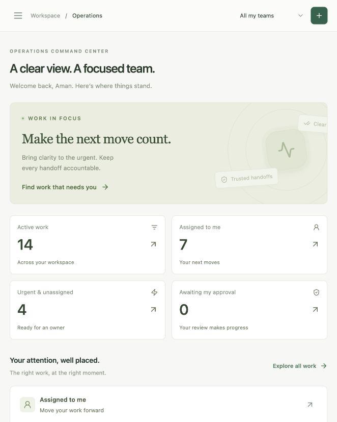
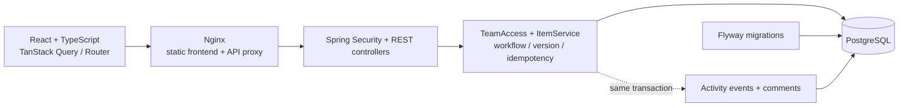

# NewtonOps

### Operations Command Center

A focused internal operations workspace for creating, claiming, progressing and approving work across teams. Built for the **Newtonite “Operations Under Pressure” challenge**, with particular attention to concurrent claims, stale edits, retries, resource authorization and accountable history.

## What you can do

- Sign in with seeded accounts and switch between authorized teams.
- See real operational metrics, personal work, urgent unassigned work, approvals and overdue queues.
- Search and filter work by team, status, priority, assignee, creation date and due date using bounded server-side pages.
- Create work with durable idempotency; claim atomically; edit with explicit versions.
- Progress OPEN → IN_PROGRESS → AWAITING_APPROVAL → RESOLVED → CLOSED; Leads may return awaiting work to IN_PROGRESS.
- Collaborate with versioned comments and inspect paginated, append-only activity.
- Use responsive layouts, accessible dialog primitives, loading/error states and reduced-motion support.

## Quick start

Prerequisites: Git, Docker Engine/Desktop with Compose v2 or later, network access to download public images and dependencies. No paid services or external credentials are required. Allow several minutes for the first build.

```bash
git clone https://github.com/Gautam-aman/Newtonite-Software-Engineering-Challenge.git
cd Newtonite-Software-Engineering-Challenge
docker compose up --build
```

Open **http://localhost:8088**. Wait for the frontend health check to pass; the backend runs Flyway and repeatable demo initialization automatically. The browser-facing port binds to loopback only; PostgreSQL and the API are on the internal Compose network.

For detached startup and an explicit readiness wait:

```bash
docker compose up --build -d --wait --wait-timeout 180
docker compose ps
```

Normal stop: `docker compose down`. The PostgreSQL volume retains work across restarts. To start a separate clean demo without deleting existing data, use `docker compose -p newtonops-fresh up --build` after stopping the other frontend that uses port 8088. Each Compose project gets its own volume.

`.env.example` documents optional development settings. Defaults work without copying it. These passwords and accounts are public **development-only** data. Set `DEMO_SEED=false` and provision real users before adapting this code for a shared environment. This project does not include public hosting, TLS termination or account provisioning.

## Demo accounts

Every demo account uses password **NewtonOps!2026**.

| Email | Team and role |
| --- | --- |
| member@newtonops.local | Platform Operations · Member |
| member2@newtonops.local | Platform Operations · Member (second claimant) |
| lead@newtonops.local | Platform Operations · Lead; Customer Experience · Member |
| viewer@newtonops.local | Platform Operations · Viewer |
| admin@newtonops.local | Platform Operations and Risk & Compliance · Admin |
| sara@newtonops.local | Customer Experience · Member |
| noah@newtonops.local | Customer Experience · Lead |
| ava@newtonops.local | Customer Experience · Viewer |
| liam@newtonops.local | Customer Experience · Member |
| outsider@newtonops.local | Risk & Compliance · Lead (cross-team denial demo) |

Sixty initial items span three teams, all five workflow states and work types, priorities, assignments, approvals and overdue dates. Demo initialization runs only when `users` is empty and is serialized with a database advisory lock. Startup never overwrites an existing user's work. Browser tokens remain in memory, so a page reload requires signing in again. Logout revokes the token on the server.

## Interface preview



[View the resolved-item screenshot](docs/screenshots/resolved-item.png).

## Architecture



This is a modular monolith using Java 21, Spring Boot 3.5, Spring Security, Spring JDBC, Bean Validation, Flyway and PostgreSQL 16 in Compose. Explicit JDBC was chosen over JPA for transparent conditional SQL and locking; the trade-off is documented. The frontend uses React 19, strict TypeScript, Vite, Tailwind 4 with a custom design system, Radix Dialog, Motion, TanStack Query, React Router, React Hook Form, Zod and Lucide.

```
backend/src/main/java/com/newtonops/
  auth/       opaque sessions and security filter
  team/       memberships and centralized permissions
  workitem/   DTOs, queries, transactional commands, dashboard
  common/     errors and development seed
backend/src/main/resources/db/migration/
backend/src/test/java/com/newtonops/
frontend/src/  connected pages, forms, UI primitives and API contracts
scripts/      test runner, HTTP smoke and repeatable bulk seed
```

No worker, message broker, ORM schema mutation or external API is needed. See [engineering decisions](ENGINEERING_DECISIONS.md) for ten decisions, exact permissions and trade-offs.

## Run tests

With **Java 21**, a running Docker daemon, Node **24 LTS** and npm:

```bash
./scripts/test.sh
```

This runs backend tests and formatting verification, installs the locked frontend dependencies, runs UI tests and builds the production frontend. Backend tests automatically start an isolated PostgreSQL 16 Testcontainer. They never use the application database by default. GitHub Actions runs both suites on pushes and pull requests.

Individual commands:

```bash
cd backend
./mvnw test
./mvnw spotless:check
cd ../frontend
npm ci
npm test
npm run build
```

For a running demo, exercise the public HTTP lifecycle with Python 3 (standard library only):

```bash
python3 scripts/smoke.py
```

This creates and closes one uniquely named item, checking login, replay, forbidden cross-team access, conflicting claims, comments, Member approval denial, Lead approval, history, dashboard and logout. It leaves an honest audit record; it does not delete test work.

Backend tests can alternatively use a dedicated local PostgreSQL database:

```bash
TEST_DATABASE_URL=jdbc:postgresql://localhost:5432/newtonops_test \
TEST_DATABASE_USER=newtonops TEST_DATABASE_PASSWORD=newtonops_dev \
./backend/mvnw -f backend/pom.xml test
```

The named database must already exist and be **dedicated to tests**; tests add records and temporarily install an audit-failure trigger. Never point it at production or the interactive demo. For Colima, set `DOCKER_HOST` to its socket and `TESTCONTAINERS_DOCKER_SOCKET_OVERRIDE=/var/run/docker.sock` if needed.

## Local development without app containers

Prerequisites: Java 21, Node 24 LTS, and PostgreSQL 15+ with an empty `newtonops` database, `newtonops` role and development password. A database owner must be allowed to install `pg_trgm` during the first Flyway migration.

Terminal one:

```bash
cd backend
DATABASE_URL=jdbc:postgresql://localhost:5432/newtonops \
DATABASE_USER=newtonops DATABASE_PASSWORD=newtonops_dev \
./mvnw spring-boot:run
```

Terminal two:

```bash
cd frontend
npm ci
npm run dev
```

Open http://localhost:5173. Vite proxies `/api` to localhost:8080. In production Compose, Nginx performs that proxying. To test the locally running API directly: `SMOKE_BASE_URL=http://localhost:8080/api python3 scripts/smoke.py`.

## Bulk data and query behavior

Optional, safe-to-rerun 5,000-item seed after demo initialization:

```bash
docker compose exec -T db psql -U newtonops -d newtonops < scripts/bulk-seed.sql
```

Items use deterministic IDs. The second run inserts neither duplicate items nor duplicate CREATED events. Counts can be checked with `SELECT count(*) FROM work_items;`. This seed is for demonstration, not a throughput benchmark.

Items use `(created_at DESC, id DESC)` keyset cursors, bounded to 1–100 results (UI page size 15). History and comments use descending IDs and bounded pages. Team/status/priority/assignee B-trees, a partial overdue index, and a trigram search GIN index support the principal query patterns. More combinations may require sorts or scans; see the decision document. Dashboard totals are separate database aggregates, not client-side counts of one page.

## API contracts and guarantees

See [API reference](docs/API.md). Errors use `{code, message, fields}` with 400 validation, 401 authentication, 403 permission, 404 missing resource, 409 conflict and 503 database unavailability. The browser has a 15-second request timeout and explicit retry/refresh states.

- **Atomic claim:** conditional PostgreSQL UPDATE, one successful owner, one version increment, one winning history event.
- **Stale-write protection:** every mutation supplies the current version; stale writes cannot overwrite committed changes.
- **Idempotent creation:** required principal-scoped key, request hash, same transaction and original persisted response. Changed payloads are rejected.
- **Team boundaries:** every protected resource and query checks current memberships; UI buttons grant no authority.
- **Transactional history:** mutations and events commit or roll back together; a trigger prevents ordinary history edits/deletes.

## Review and presentation

- [Engineering decisions and permission matrix](ENGINEERING_DECISIONS.md)
- [3–5 minute demo guide](DEMO_GUIDE.md)
- [Interview preparation and 100-word submission answer](INTERVIEW_PREP.md)
- [Final delivery report](docs/SUBMISSION_REPORT.md)
- [Verification record](docs/VERIFICATION.md)
- [Implementation checklist](docs/IMPLEMENTATION_PLAN.md)

## Known limitations and next steps

The scope deliberately excludes delete/reopen (use closure), signup and team administration, attachments, outbox/notifications, websockets, SSO/MFA, password recovery, deployment and demo video. Admin has Lead capabilities inside its teams; self-approval is allowed. Viewer memberships can read only. No two-person approval policy was assumed.

Authentication has no rate limiter or refresh-token system. Session and idempotency records have no cleanup scheduler. Tokens are memory-only; reload requires login. A database owner could disable audit triggers, so the log is not claimed to be tamper-proof. Public exposure needs HTTPS, managed credentials, abuse controls and a production threat review. The demo uses a single database without automatic failover.

Search, dashboard aggregation and cursor stability are tested for behavior, not benchmarked at production scale. Pagination is sequential, with no exact total on every list query. Small screens use a horizontally scrollable work table. Accessibility primitives, keyboard focus, labels and reduced-motion support are implemented; no formal accessibility certification or exhaustive device matrix is claimed. The current frontend bundle emits a Vite size advisory; route splitting is a future refinement.

Next improvements would be production auth hardening/cleanup, measured query tuning, a notification outbox only when required, independent approver policy if requested, and more browser/accessibility automation.
